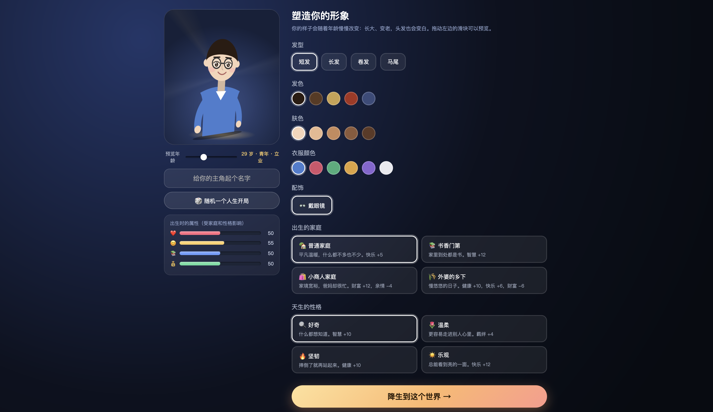
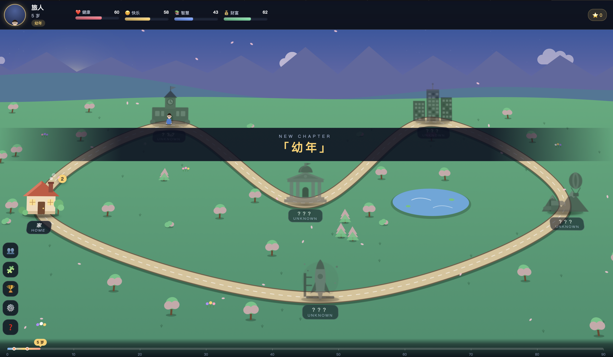
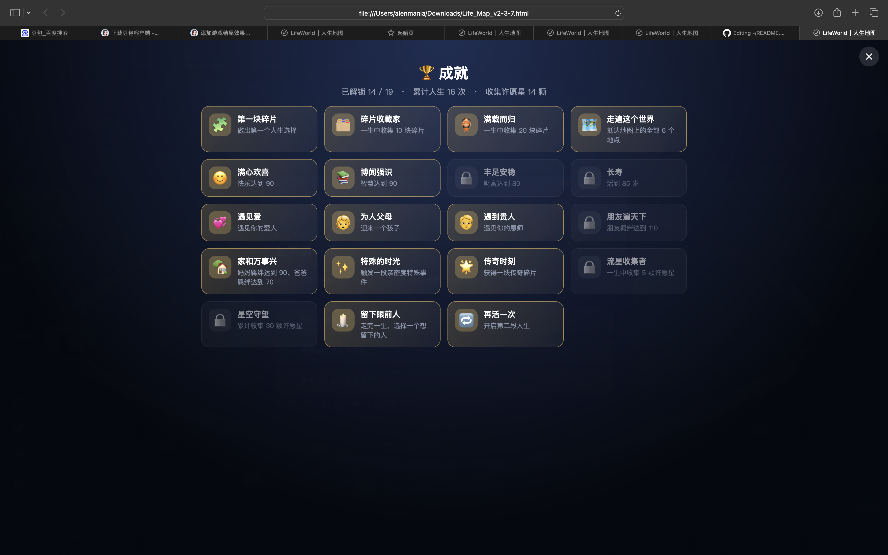

运行提示：所需文件均在Python文件夹里面，请将后两个mp3放在一个叫作audio的文件夹并与html置于一起，html文件不要在audio文件夹内，而是与audio文件夹并列

##项目名称 Life Map   主题：Your Life as a World
项目简介

本项目是一个基于 HTML、CSS 和 JavaScript 开发的交互式人生模拟体验程序。

用户可以创建自己的角色，通过不同人生阶段的选择体验虚拟人生发展过程，包括童年、学习、职业、人际关系、生活事件等多个方面。

项目通过交互式选择、动态页面更新以及多媒体元素增强用户体验。

---

#功能实现状态

| 功能 | 状态 |
|---|---|
| 用户角色创建 | 已完成 |
| 用户年龄/人生阶段系统 | 已完成 |
| 人生事件随机生成 |  已完成 |
| 多选项人生决策 | 已完成 |
| 属性变化系统（财富、健康、能力等） | 已完成 |
| 人生结局生成 | 已完成 |
| 图片角色展示 | 已完成 |
| 背景音乐与音效 | 已完成 |
| 响应式网页设计 | 已完成 |
| 数据保存功能 | 部分完成 |

---

# 核心文件清单

| 文件 | 功能 |
|---|---|
| Life Map.html | 项目主页面，负责网页结构 |
| style.css | 页面样式设计 |
| script.js | 核心逻辑，包括事件系统和人生模拟算法 |
| audio/ | 存放背景音乐和音效 |
| images/ | 存放角色图片及其他素材 |
| screenshots/ | 项目运行截图 |
| AI_USAGE.md | AI辅助开发说明 |

---

# 使用方法

## 方法1：本地运行

1. 下载项目文件
2. 打开 `Life Map.html`
3. 使用浏览器运行项目

推荐浏览器：

- Google Chrome
- Microsoft Edge
- Safari

---

# 项目主要功能介绍

## 1. 角色创建系统

用户可以选择角色外观和基础信息，系统会根据用户选择生成对应人物。

## 2. 人生模拟系统

程序按照年龄阶段推进：

- 儿童时期
- 青少年时期
- 大学阶段
- 工作阶段
- 成年生活
- 老年阶段

每个阶段都会产生不同事件。

例如：

- 学习选择
- 职业选择
- 人际关系
- 财富管理
- 生活决策

## 3. 属性变化系统

用户的选择会影响：

- 智力
- 健康
- 财富
- 幸福感
- 社交能力

最终根据综合属性生成不同人生结局。

##  4.碎片系统与成就系统
主题：Your Life as a World
  本项目将人的生活记忆拆分为**人生碎片系统**与**成就达成系统**，把零散的生命痕迹，构筑成一片可供漫游的个人世界。

**人生碎片系统**：收集生活里所有细碎痕迹 —— 照片、文字、音频、地点、偶遇、思绪、日常瞬间。碎片不以时间线强行排序，依靠情绪、人物、场景自动聚类，生长成世界里的山川、屋舍、湖泊与迷雾荒原。遗忘的碎片隐入迷雾，待漫游偶遇时才缓缓显现；每一块碎片都是这个世界的砖瓦，持续扩充疆域。

**成就达成系统**：不同于游戏里预设的任务目标，这里的成就源自你真实的生命体验。它记录坚持、突破、相遇、和解，甚至接纳与放下这类柔软的内在成长。当你收集到特定组合的人生碎片，便自动解锁对应成就，化作世界里独特的纪念碑、雕塑或是古树，永久矗立在这片大陆上，成为你人生里程碑的可视化印记。

在这里，回忆不再是列表，成就不再是打卡。漫游属于你的世界，捡拾过往碎片，见证自己一步步铸就的生命疆域。
*Turn a life into a world.*

---

# 技术实现

## 前端技术

- HTML5
- CSS3
- JavaScript

## 使用的主要技术

- DOM 操作
- Event Listener
- JavaScript Object 数据结构
- Array 数组管理事件
- 条件判断
- 随机事件生成

---

# 截图展示

项目运行截图：

1.

2.

3.

---

# Demo演示

在线演示：见demo文件夹链接

# 开发环境

操作系统：

Windows / macOS

浏览器：

Chrome / Safari

开发工具：

VS Code

---

# 开发者

姓名：丁墨涵

学号：2630034021

课程：编程马拉松

日期：2026/10/12
